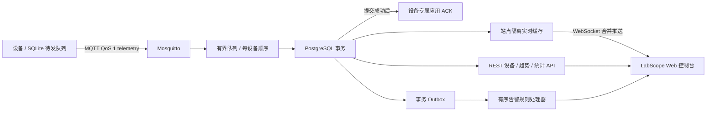

# LabScope 工业设备遥测与实时监控

LabScope 是基于 Drogon 的工业设备遥测与运行监控系统。设备通过 MQTT 上报测点；服务端以有界队列、按设备顺序持久化和 PostgreSQL 事务保证数据落库后才发布应用层 ACK。Web 控制台提供设备台账、实时趋势、告警处置、规则管理和系统健康页面。它是监测与运维系统，不提供设备控制命令。

项目在 Drogon 之上实现了面向工业遥测的业务能力：设备端 SQLite outbox 与提交后 ACK、重复序号幂等处理、原始/分钟聚合历史、站点级访问控制、带回差/持续时间/冷却时间的告警状态机、事务 outbox 告警处理、不可变审计记录，以及 Prometheus 低基数运行指标。Drogon 作为未修改的框架依赖，项目业务代码和前端均独立维护。

## 数据流



MQTT 的 QoS 1 PUBACK 只确认 broker 到服务端的传输，不作为数据库确认。只有数据库事务成功后服务端才发送 `persisted` 或 `duplicate` 应用 ACK；瞬时存储错误不发应用 ACK。模拟设备在本地 SQLite 保留未确认的原序号和载荷，收到永久 `rejected` 后转入死信表。

告警处理器按每设备顺序领取已提交的 outbox 事件，并将规则状态、事件转移和 outbox 完成标记放入同一事务。阈值规则支持持续时间、恢复回差与冷却时间；确认操作要求 operator/admin 角色和 CSRF token，并与审计事件原子提交。

## 本地 Compose 启动

需要 Docker Desktop 或 Linux Docker Engine、Docker Compose v2、Python 3.10+、Node.js 24（仅前端本地开发/构建）和 C++20 编译器（仅本地 C++ 构建）。首次启动会拉取固定版本的 PostgreSQL、Mosquitto、Flyway、Node 和 Nginx 镜像，并从 Drogon `v1.9.13` 源码构建服务。

```powershell
Copy-Item .env.example .env
docker compose up --build -d
docker compose ps
```

打开 <http://127.0.0.1:8080/>。Compose 将数据库和 MQTT broker 数据放入命名卷，HTTP、PostgreSQL 和 MQTT 端口仅绑定回环地址。开发环境默认口令仅供本机演示；使用前应在 `.env` 中换成随机口令。

创建首个管理员账号（密码通过终端安全输入，不放在命令行参数中）：

```powershell
python tools/create_admin.py labadmin
```

为站点创建操作员或观察者账号时，重复 `--site-id` 指定授权范围；这条 CLI 会校验站点并把用户创建/站点授权写入审计日志：

```powershell
python tools/create_web_user.py operator-a operator --site-id plant-a
python tools/create_web_user.py observer-a viewer --site-id plant-a --site-id plant-b
```

浏览器登录后可按角色使用系统：`admin` 可访问所有启用站点并创建/启停告警规则；`operator` 可在被授权站点确认活动告警；`viewer` 只读。设备凭据与 broker ACL 通过下方 provisioning CLI 管理。用户管理通过本机受控 CLI 完成，当前没有 Web 用户管理页面；请勿通过公开接口暴露数据库管理凭据。

停止服务但保留数据：

```powershell
docker compose down
```

清除数据库、broker 和设备模拟器数据卷会永久删除本地数据：

```powershell
docker compose down --volumes
```

## 发放测试设备与运行模拟器

先启动 Compose。在 PowerShell 中加载 `.env` 供本机凭据 CLI 使用，再创建一台设备。生成的设备密码只在创建/轮换时输出，并可保存到被 Git 忽略的 `data/device-credentials.json`：

```powershell
Get-Content .env | ForEach-Object {
  if ($_ -match '^([^#=]+)=(.*)$') { [Environment]::SetEnvironmentVariable($matches[1], $matches[2]) }
}
python tools/provision_device.py create `
  --site-id plant-a --device-id device-0001 `
  --credentials-file data/device-credentials.json
```

启动短时验证负载：

```powershell
python tools/mqtt_device_sim.py --site-id plant-a `
  --credentials data/device-credentials.json --devices 1 `
  --rate-hz 1 --duration-sec 30
```

模拟器为每台设备创建 MQTT 客户端，凭据 JSON 中的设备编号需为 `device-0001`、`device-0002`……。`sensor-spike` 和 `sequence-gap` 故障档案可用于观察异常测点与序号缺口。

批量容量目标是 **1,000 台设备 × 1 条/秒、持续 10 分钟**。要运行该目标，先准备好对应的 1,000 组设备和凭据，再执行：

```powershell
python tools/bench_mqtt.py --site-id plant-a `
  --credentials data/device-credentials.json --devices 1000 `
  --rate-hz 1 --duration-sec 600
```

每次运行输出独立 JSON 到 `docs/benchmarks/run-<UTC 时间>.json`。报告记录测试主机、工作负载、确认计数、吞吐、ACK 延迟分位数、重试、重连、未完成队列和工作错误。容量目标是待测验收目标；仓库不包含持久化链路的现场性能承诺或伪造的基准结果。详细说明见 [`docs/benchmarks/README.md`](docs/benchmarks/README.md)。

轮换和撤销设备凭据：

```powershell
python tools/provision_device.py rotate --site-id plant-a --device-id device-0001 `
  --credentials-file data/device-credentials.json
python tools/provision_device.py revoke --site-id plant-a --device-id device-0001 `
  --credentials-file data/device-credentials.json
```

撤销会禁用 broker 客户端并标记数据库设备禁用。设备 ACL 只允许向自己的遥测主题发布、订阅和接收自己的 ACK。

## C++ 本地构建

项目默认从相邻目录引用 Drogon 源码 `../drogon-master/drogon-master`，不修改上游 Drogon。Windows 本地构建需要 Visual Studio 2022、CMake、vcpkg 和 Python。请将 `VCPKG_ROOT` 设置为本机 vcpkg 根目录，并将 `DROGON_SOURCE_DIR` 改为 Drogon 1.9.13 源码目录：

```powershell
cmake -S . -B build -G "Visual Studio 17 2022" -A x64 `
  -DCMAKE_TOOLCHAIN_FILE="$env:VCPKG_ROOT/scripts/buildsystems/vcpkg.cmake" `
  -DDROGON_SOURCE_DIR="C:/src/drogon" `
  -DBUILD_TESTING=ON
cmake --build build --config Debug --target lab_telemetry --parallel 8
ctest --test-dir build -C Debug --output-on-failure
```

如果 Windows CMake 或 vcpkg 子进程无法处理含中文的工作区路径，先用 `subst` 映射 ASCII 盘符后运行同一命令。容器构建会单独检出 Drogon `v1.9.13` 和其子模块。

## Web 前端

```powershell
cd web
npm ci
npm test -- --run
npm run build
npm run dev
```

本地 Vite 服务将 `/api`、`/healthz`、`/ws` 代理到 `http://127.0.0.1:8848`。生产静态资源由 Nginx 提供，并将 REST、健康检查、指标和 WebSocket 请求反向代理到 Drogon 服务。

控制台包含运行总览、设备台账、设备详情（15 分钟原始样本或 24 小时分钟聚合）、告警中心、告警规则和系统健康页面。会话由服务端保存，浏览器只持有 HttpOnly、SameSite cookie；写请求使用会话绑定的 CSRF token。非开发环境需通过 HTTPS，并设置 `LABSCOPE_COOKIE_SECURE=1`。服务端角色校验是最终权限边界，页面隐藏按钮只用于改善操作体验。

## 运维指标与权限

`/api/v1/system/health` 需要登录，返回 PostgreSQL 查询状态、MQTT 连接状态、写入队列深度/容量、实时订阅数和保留维护调度状态。`/healthz` 只检查 HTTP 进程是否响应。`/metrics` 提供 Prometheus exposition 文本，包含接收/提交/重复/拒绝计数、队列满与重试、接收至数据库完成延迟、MQTT 连接/重连、队列深度、WebSocket 数、数据库序号缺口和活动告警数；指标不带 device/site/user 等高基数标签。生产部署应将 `/metrics` 限制在监控网络内。

| 操作 | admin | operator | viewer |
| --- | --- | --- | --- |
| 读取已授权站点的设备、趋势和告警 | 是 | 是 | 是 |
| 读取系统运行状态 | 是 | 是 | 是 |
| 确认活动告警并填写处置备注 | 是 | 是 | 否 |
| 创建或启停告警规则 | 是 | 否 | 否 |
| 设备凭据发放、轮换、撤销 | CLI | CLI | 否 |

## 数据留存、备份与恢复

- `telemetry_samples` 按日分区，默认保留最近 24 小时原始遥测。
- `telemetry_1m` 保存一分钟的 min/max/avg/count，默认保留 30 天。
- 应用每小时调用 PostgreSQL 维护函数，补建未来分区并执行过期清理。
- 开发环境数据库卷名为 `labscope_db_data`（Compose 项目名变化时卷前缀也会变化）。

在 Linux/macOS 备份数据库：

```sh
mkdir -p backups
docker compose exec -T db pg_dump -U "${POSTGRES_USER:-labscope}" \
  -Fc "${POSTGRES_DB:-labscope}" > "backups/labscope-$(date -u +%Y%m%dT%H%M%SZ).dump"
```

恢复到已启动的本地数据库：

```sh
docker compose exec -T db pg_restore -U "${POSTGRES_USER:-labscope}" \
  -d "${POSTGRES_DB:-labscope}" --clean --if-exists < backups/labscope-YYYYMMDDTHHMMSSZ.dump
```

部署前应另行安排备份文件的加密、异机保存、恢复演练、Mosquitto 动态安全数据目录备份和磁盘空间监控。单机 Compose 不提供自动故障切换或高可用。

## 当前边界

当前交付以单节点 Compose 为目标，不包含高可用、自动故障切换、TLS 证书终止、集中式身份管理或 Web 用户管理。尽管默认端口绑定回环地址，本系统也不能直接暴露到公网或生产 OT 网络。正式部署前需完成网络隔离、TLS、凭据轮换、备份恢复演练、依赖升级审查和现场验收。`LABSCOPE_COOKIE_SECURE=0` 仅用于本机开发。Modbus TCP 采集尚未实现。

## 验证与简历事实

已实现部分可表述为：Drogon C++20 服务、MQTT QoS 1 接入、有界分设备有序队列、PostgreSQL 幂等持久化和事务后应用 ACK、SQLite 设备 outbox、站点隔离会话、角色/CSRF 权限、告警迟滞状态机与事务 outbox、操作审计、Vue 运维台和低基数 Prometheus 指标。请把“1,000 台 × 1 Hz”说成容量验收目标，只有完成实际压测并保存报告后才能称为实测成绩。

验证命令：

```powershell
python -m unittest discover -s tests -p "*test.py" -v
cmake --build build --config Debug --target lab_telemetry_tests
ctest --test-dir build -C Debug -R "^(telemetry_validator|ingestion_queue|ack_publisher|mqtt_config|telemetry_persistence_contract|password_hasher|auth_authorization|alarm_evaluator|telemetry_metrics)$" --output-on-failure
cd web; npm test -- --run; npm run build
```

数据库/MQTT HTTP 烟雾验收需要 Compose 服务和测试账号可用：设置 `LABSCOPE_E2E_USERNAME`、`LABSCOPE_E2E_PASSWORD`，可选设置 `LABSCOPE_E2E_SITE_ID`，然后运行 `python tests/e2e/operations_console_smoke.py`。该脚本验证登录会话、站点读取、设备/告警 API、系统健康、指标和 Web 静态入口，不会创建或修改业务数据。完整 1,000 台 × 1 Hz、10 分钟容量目标需单独执行 `tools/bench_mqtt.py` 并审阅其 JSON 报告。

若尚未启动可用的 PostgreSQL/Mosquitto/Compose 环境，应将数据库迁移、HTTP/WebSocket 角色矩阵、备份恢复和容量数据标记为未验证；单元/静态契约通过不等于现场集成通过。
